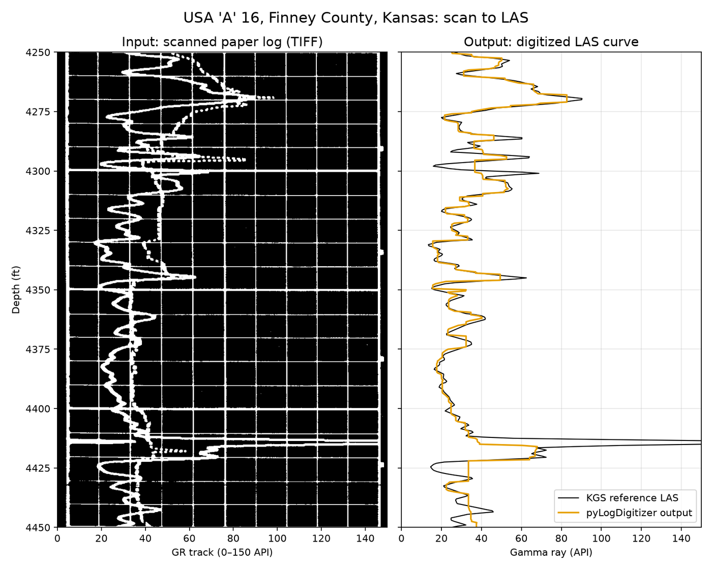
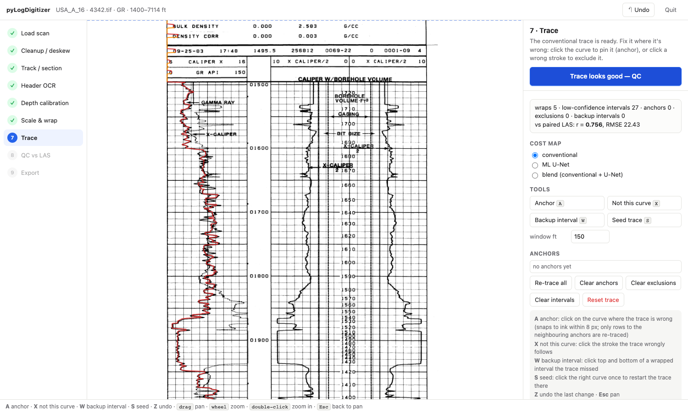
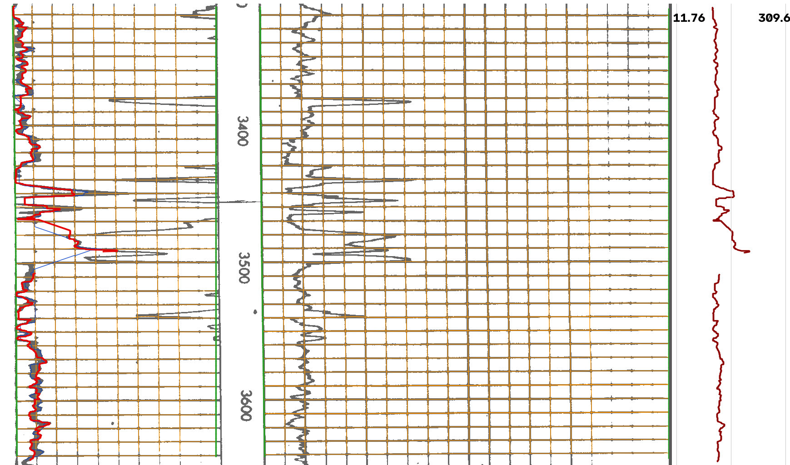
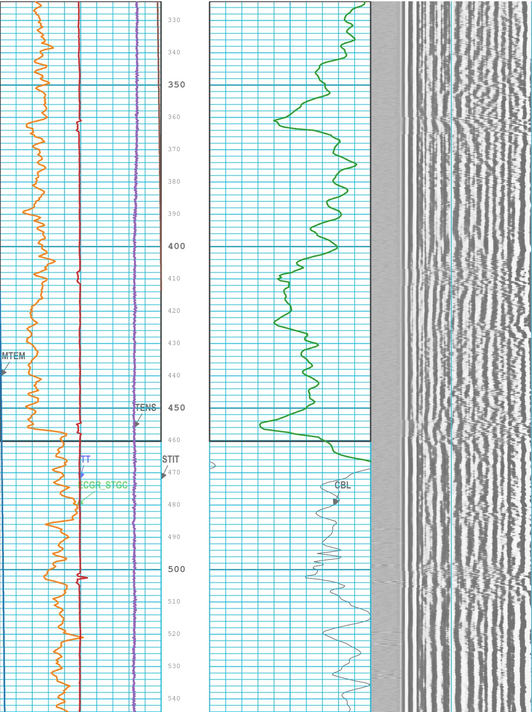
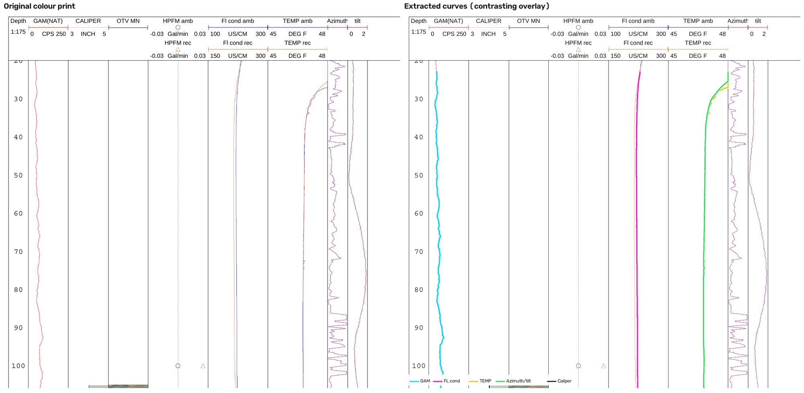
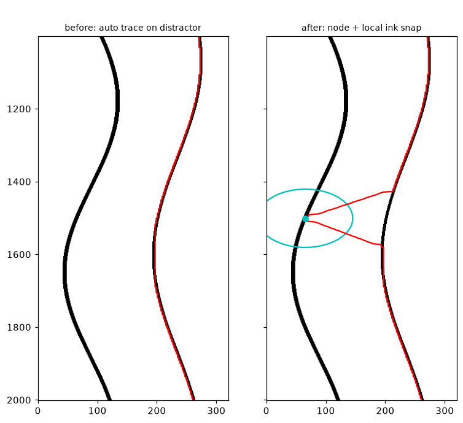

<p align="center"></p>
<p align="center">
<a href="https://doi.org/10.5281/zenodo.23832013"></a> <a href="https://github.com/GeoLarryLai/pyLogDigitizer/blob/main/LICENSE"></a>
<br>
<a href="https://pypi.org/project/pylogdigitizer/"></a> <a href="https://pypi.org/project/pylogdigitizer/"></a> <a href="https://pepy.tech/projects/pylogdigitizer"></a> <a href="https://anaconda.org/conda-forge/pylogdigitizer"></a> <a href="https://anaconda.org/conda-forge/pylogdigitizer"></a>
</p>

# pyLogDigitizer

> [!WARNING]
> **pyLogDigitizer** is under active development, and many functions are still experimental and not fully validated. Please use with caution.

**pyLogDigitizer** turns well-log prints into LAS files. It takes two kinds of input that share the same scale, depth, null and LAS code:

1. **Inked paper scans (TIFF)** — older wells that only exist as raster scans.
2. **Clean colour digital-print PDFs** — modern vector prints read straight from their paths with `pypdf` (no rasterizing, no scan model).

Digitizing by hand is slow and hard to check. So I built a tool that does the tedious parts — finding tracks and grids, reading depth labels, separating curve ink from the grid, tracing each curve — and gives you a local browser app to review and fix every step. Overlay QA draws the grids and traces on the original scan or the real rendered PDF page so you can check alignment by eye. Curves that run off a track and come back on a backup scale are unwrapped automatically. Everything runs on your own machine and nothing is uploaded.


*The whole idea in one picture: a scanned paper log going in and a LAS curve coming out.*

## Installation

```bash
pip install pylogdigitizer
```

From source (builds the Rust tracer, needs a Rust toolchain):

```bash
git clone https://github.com/GeoLarryLai/pyLogDigitizer && cd pyLogDigitizer
pip install .
```

Or `conda env create -f environment.yml && conda activate pylogdigitizer`, then `maturin develop --release`.
Without the Rust part everything still works, only slower.

## Citation

Lai, L.S.-H. (2026) pyLogDigitizer. *Zenodo*, [https://doi.org/10.5281/zenodo.23832013](https://doi.org/10.5281/zenodo.23832013)

## What it can do

**Scan path (inked TIFF).** Find tracks and grids, deskew the sheet, OCR the depth labels and calibrate scales (including backup-scale wraparound). A small bundled ONNX segmenter separates curve ink from grid and text — default `scan_seg_v2`, with `scan_seg_overflow` opt-in when the print has overflow spikes. Meant as a general scan model; you shouldn’t need to retrain per print. Optional retraining writes to your own folder (`notebooks/03_train_scan_segmenter.ipynb`) and never overwrites the bundled default. Curves are then traced with a fast dynamic-programming tracer (Rust, with a Python fallback).

**Digital-print path (colour PDF).** Read vector paths with `pylogdigitizer.pdf_vector.digitize_pdf`. Auto-identifies the header, upper/lower scale sections and grids per track/column, and digitizes each curve separately. No rasterizing and no scan segmenter — the PDF already has clean coloured strokes. Public examples below include Utah FORGE CBL and a USGS D-522 colour print.

**Check by eye.** Overlay QA draws identified grid lines and traced curves on the original scan or the real rendered PDF page, so alignment is something you can see, not only a LAS score.

**Fix in the local browser app.** `pylogdigitizer-app` is the place to review and correct: pin/drag anchors, re-trace inside a cursor circle, or drop a node (**D**) that snaps to potential curve ink inside an adjustable-diameter circle (or uses the clicked point) and reconnects the curve above and below instantly with no model rerun. You can also nudge track edges, set a scale from two grid lines, and click any OCR word in the header to correct it.

**Out to LAS.** Writes LAS 2.0. Step 0.5 ft by default, 0.25 ft optional. Log scales, nulls where a curve is clipped by the track’s fixed scale, and backup-scale wrap / off-chart overflow (valued correctly and drawn where the backup stroke sits on the print) are all supported.

On some multi-curve digital prints a GR piece may be only partly captured (FORGE porosity is the example); messy multi-curve inked scans are meant to be fixed in the editor rather than fully automatically.

## Examples


*The local browser app: a traced curve laid over the scan, with tools to pin, exclude and re-trace before you export.*


*Chitwood 12 (KGS): digitized GR against the paired KGS LAS, with a depth plot and a cross-plot.*


*Chitwood 12 (KGS): traced GR and snapped grid lines drawn on the original scan, so you can check that the grid sits on the printed lines in every track.*


*Minzer 1 (KGS): high-value overflow is read on the backup scale and drawn where the backup stroke actually sits on the print.*


*Utah FORGE 78B-32 CBL, page 7: digitized curves and the PDF’s own grid lines drawn on the rendered colour page.*


*USGS D-522: original colour digital-print (left) and the same page with extracted curves drawn back in contrasting colours (right) — gamma, fluid conductivity, temperature, azimuth/tilt.*


*Node editor: drop a node (D) that snaps to nearby ink inside an adjustable circle and reconnects the curve instantly, without rerunning the model.*

Scan examples are from the [Kansas Geological Survey](https://www.kgs.ku.edu/) (`example_data/SOURCES.txt`). Colour digital-print examples are the public Utah FORGE 78B-32 CBL ([GDR / OpenEI](https://gdr.openei.org/)) and a USGS GeoLog Locator print (D-522).

Notebooks: `notebooks/pdf_vector_demo.ipynb` (digital-print PDF → LAS), `notebooks/03_train_scan_segmenter.ipynb` (optional ONNX retrain into your own folder), plus `notebooks/01_conventional_vs_assisted.ipynb` and `notebooks/02_kansas_ml_train_batch.ipynb` for the scan / cost-map workflow.

## Quick start

A usual scan flow is: open the local app on a folder of TIFFs, step through cleanup → tracks → depths → scale → trace, fix anything that looks off, then export LAS. The same steps are available from the CLI and from Python. Digital-print PDFs go through `digitize_pdf` and write LAS directly (you can still overlay-check the page).

```bash
pylogdigitizer info example_data/USA_A_16_15-055-20536/4342.tif   # scan size and resolution
pylogdigitizer-app .                        # the app at http://127.0.0.1 (local only); `pylogdigitizer editor .` is an alias
```

Scan path from Python:

```python
from pylogdigitizer import workflows as wf
R = wf.digitize_curve("example_data/USA_A_16_15-055-20536/4342.tif", track="track1", scale=(0, 150),
                      first_depth=1500, depth_range=(1500, 7030), backup=(150, 300))
R["depth"], R["value"], R["conf"]           # then las_export.resample + write_las
```

`backup=(150, 300)` is the **backup scale**: when a curve runs off the edge of its track it is redrawn from the other edge on a second scale, and the tracer unwraps it.

Digital-print PDF path (pages are 0-based; step 0.5 ft is the default):

```python
from pylogdigitizer.pdf_vector import digitize_pdf

log = digitize_pdf("UniversityofUtah_Forge78B-32_6Oct21_CBL.Pdf", step=0.5)
log.to_las("forge_cbl.las")
```

The optional ML cost map (`cost_mode="ml"` or `"blend"`) needs PyTorch and a trained checkpoint. Without them the tracer uses the conventional cost map.

Third-party notices and data credits: [`NOTICE`](NOTICE).
