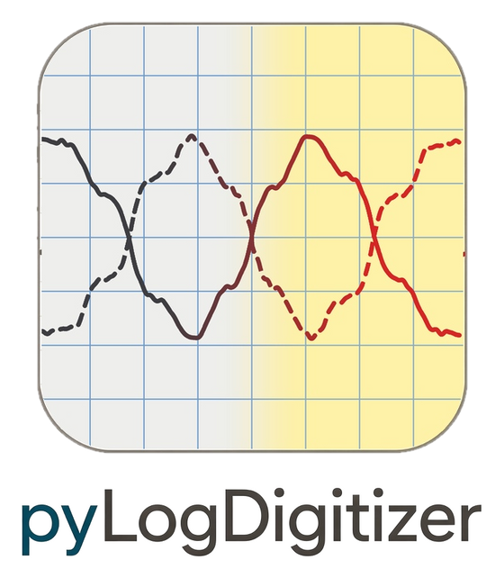
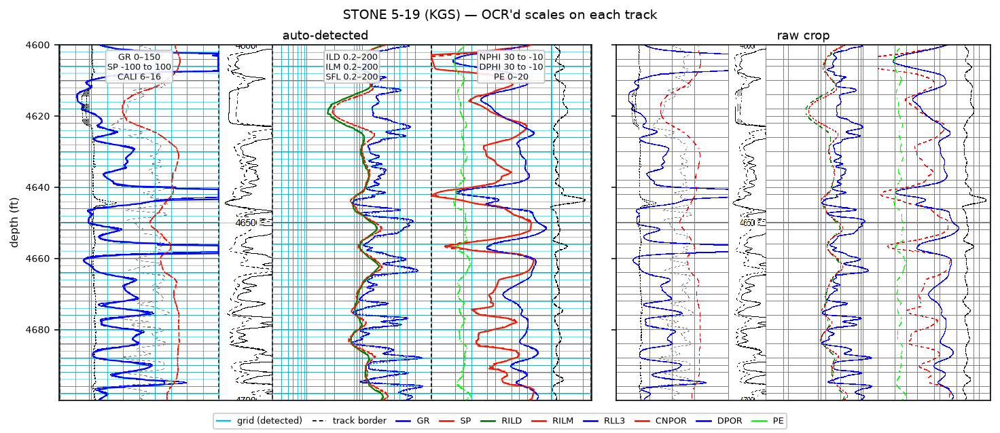
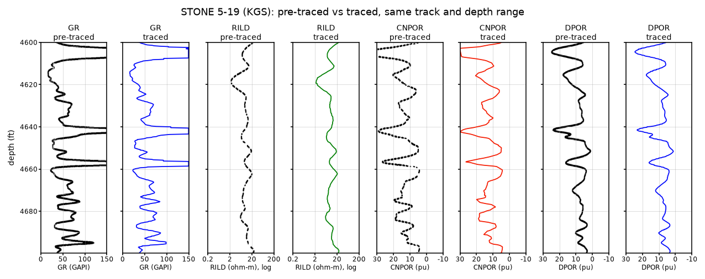
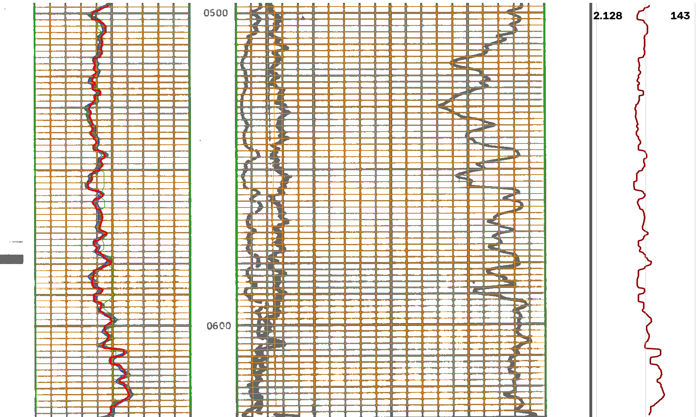
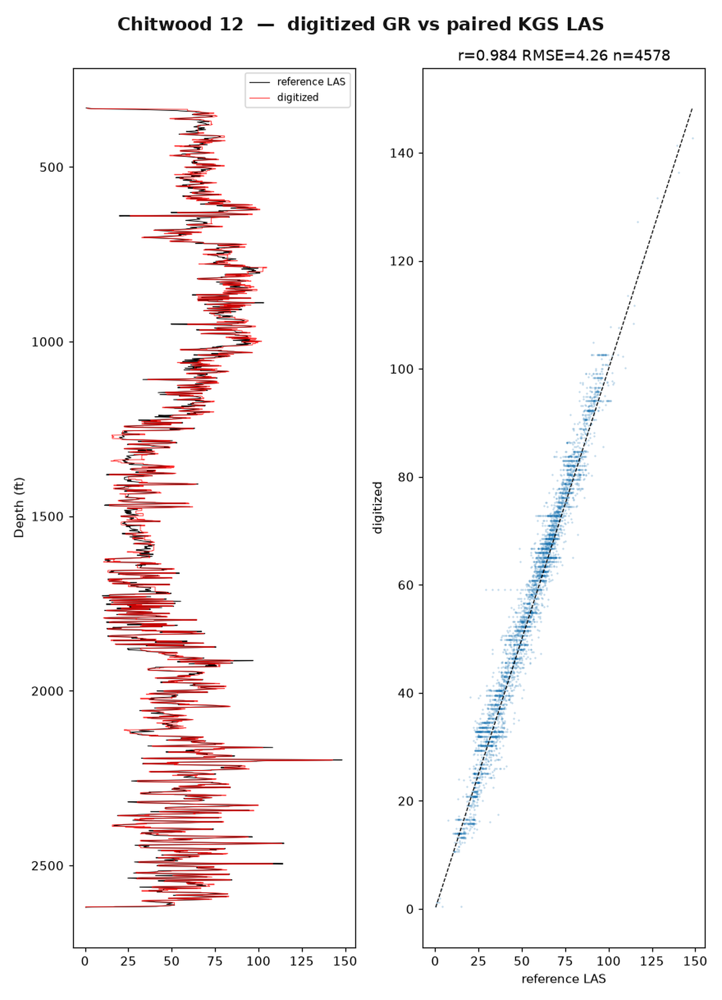
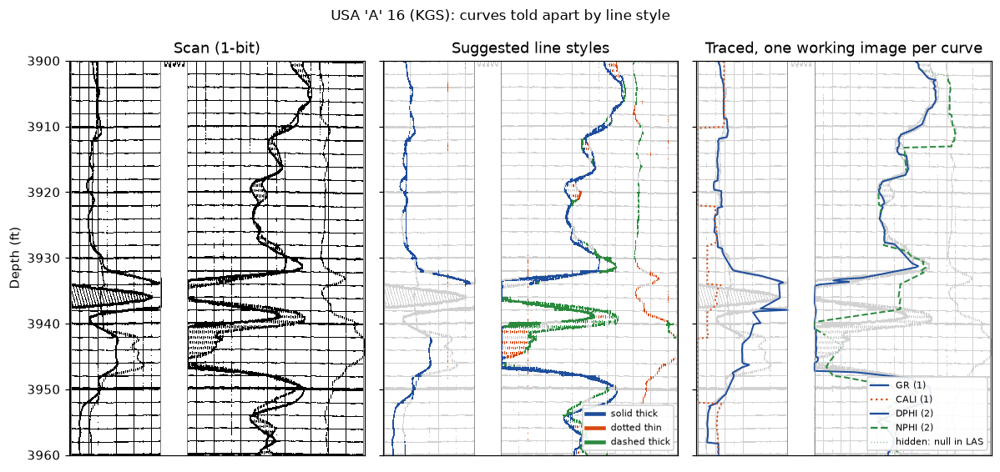
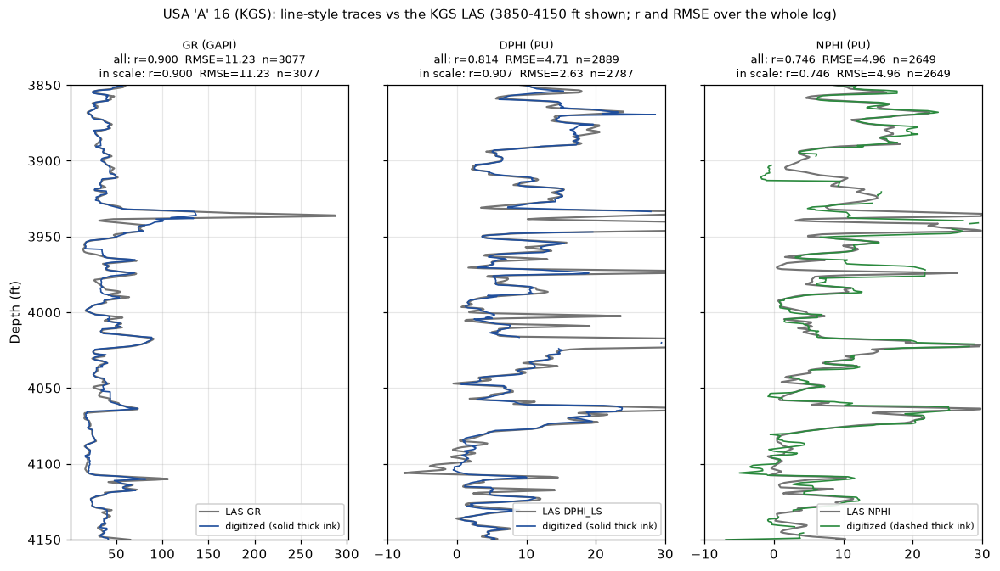
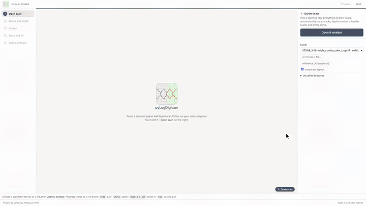
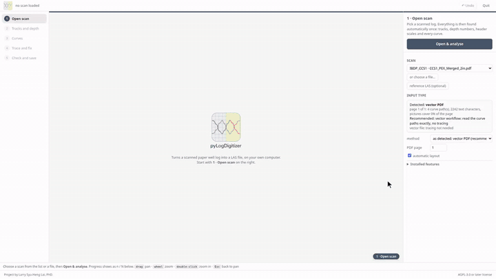

<p align="center"></p>
<p align="center">
<a href="https://doi.org/10.5281/zenodo.23832013"></a> <a href="https://github.com/GeoLarryLai/pyLogDigitizer/blob/main/LICENSE"></a>
<br>
<a href="https://pypi.org/project/pylogdigitizer/"></a> <a href="https://pypi.org/project/pylogdigitizer/"></a> <a href="https://pepy.tech/projects/pylogdigitizer"></a> <a href="https://anaconda.org/conda-forge/pylogdigitizer"></a> <a href="https://anaconda.org/conda-forge/pylogdigitizer"></a>
</p>

# pyLogDigitizer

> [!WARNING]
> **pyLogDigitizer** is under active development, and many functions are still experimental and not fully validated. Please use with caution.

**pyLogDigitizer** is a machine-learning-assisted digitizer that turns well-log image scans and digital-print PDFs into LAS files. It finds the tracks, grid and depth numbers, reads the curve header, tells the curves apart (by ink colour on colour scans, by line style on black-and-white scans) and traces each one. A local browser app lets you check and fix every step. Everything runs on your own computer; nothing is uploaded.

## Installation

Requires Python 3.10 or newer.

**From PyPI**

```bash
pip install pylogdigitizer
```

or from `conda-forge` repository with `conda`:

```bash
conda install pylogdigitizer
```

**From GitHub** (latest development version)

```bash
pip install git+https://github.com/GeoLarryLai/pyLogDigitizer
```

or, from a local clone:

```bash
git clone https://github.com/GeoLarryLai/pyLogDigitizer
cd pyLogDigitizer
pip install -e .
```

Installing from source builds the Rust tracer and needs a Rust toolchain. Without the Rust part everything still works, only slower.

## Supported input files

The app opens TIFF, PNG, JPEG and PDF, plus an optional LAS file as a reference. The Python API loads TIFF, PNG and JPEG, or any other still image Pillow can open. A scanned (raster) PDF is read from the image on the first page. A digital-print PDF that still has vector curves is read straight from its line drawings (experimental). Multi-page files use only the first page, except vector PDFs, where the page with the curves is found on its own.

## What it can do

- Machine-learning assisted: a bundled U-Net (a small neural network) sorts every pixel of a scan into paper, grid, curve or text so tracing follows only curve ink, and deep-learning OCR reads curve names and scales from the header. Both are pretrained, run on an ordinary computer with no training per file, and can be retrained on your own scans.
- Read colour image scans and tell the curves apart by ink colour.
- Read black-and-white scans and tell the curves apart by line style (solid, dashed, dotted; thin or thick).
- Find tracks, grid lines and depth numbers on their own, and read curve names and scales from the header with OCR.
- Trace every curve and read off-scale stretches on the backup scale where they wrap back in from the other edge.
- Check and fix everything in a local browser app.
- Write LAS 2.0 (0.5 ft step by default, or any step you type), plus figures and an optional CSV. Traces are dense and never smoothed.
- Vector PDFs (curves stored as lines, not pixels) are detected automatically and read straight from the file, with no tracing; mixed PDFs take the header from the PDF text and trace the curves (experimental).

**Limitations**

- Works best on colour scans, where the ink colour tells the curves apart.
- Black-ink scans have higher uncertainty: there is no colour to guide which stroke belongs to which curve.
- Needs a readable header and printed scales; otherwise names and scales are typed in the app.
- Tested on Kansas Geological Survey (KGS) style sheets so far.

## Examples

**STONE 5-19 (KGS), colour raster.** A triple combo printed by plotting software and stored as pixels only, so every curve is recovered from its coloured ink.

*Data: STONE 5-19, BEREXCO, LLC., API 15-055-22611, Finney County, Kansas; a crop of the colour log scan 600699.tif and its LAS, from the [KGS well page](https://chasm.kgs.ku.edu/ords/qualified.well_page.DisplayWell?f_kid=1054891848).*


*STONE 5-19 (KGS), 4600–4700 ft: what pyLogDigitizer found on its own — three tracks and the depth column, grid lines, OCR'd header scales, one row per curve (GR 0–150, SP −100 to 100, CALI 6–16; ILD, ILM, SFL 0.2–200 log; NPHI, DPHI 30 to −10; PE 0–20) and eight traced curves in their print colours, next to the raw crop.*


*STONE 5-19 (KGS): pre-traced ink (the curve's own stroke, cropped to its track) next to the trace for GR, RILD, CNPOR and DPOR, on the same track extent, printed-scale ticks and depth range.*

**Challenging examples: black-and-white ink scans.** The package also does its best on older black-and-white scans, with higher uncertainty, since there is no colour to tell crossing or touching curves apart. Where one curve's dashes are hidden under another curve's stroke, those depths are written as null, never as the other curve's values.

*Data: Chitwood 12, Lion Oil Co., API 15-151-10469, Pratt County, Kansas; scan 260245.tif and its LAS, from the [KGS well page](https://chasm.kgs.ku.edu/ords/qualified.well_page.DisplayWell?f_kid=1001272599).*

| Chitwood 12 (KGS): traced GR on the scan | Chitwood 12 (KGS): digitized GR vs the KGS LAS |
|---|---|
|  |  |

*Chitwood 12 (KGS): traced GR and snapped grid lines drawn on the original scan (left), and the digitized GR against the paired KGS LAS, with a depth plot and a cross-plot (right).*

*Data: USA 'A' 16, Helmerich and Payne, Inc., API 15-055-20536, Finney County, Kansas; a crop of scan 4342.tif and its LAS, from the [KGS well page](https://chasm.kgs.ku.edu/ords/qualified.well_page.DisplayWell?f_kid=1006052147).*


*USA 'A' 16 (KGS), 3900–3960 ft: the 1-bit scan, the curve ink labelled by line style, and the per-curve traces drawn back in their style.*


*USA 'A' 16 (KGS): GR, density porosity and neutron porosity traced by line style (colour) against the KGS LAS (grey), with r and RMSE over the whole log. It works, but less exactly than on a colour scan.*

All example scans and LAS files are from the [Kansas Geological Survey](https://www.kgs.ku.edu/) (details in `example_data/SOURCES.txt`). The source of this material is the Kansas Geological Survey website at http://www.kgs.ku.edu/. All Rights Reserved. Notebook 06 downloads its vector PDF and LAS on demand from the Illinois Basin – Decatur Project (credit: Illinois State Geological Survey, IBDP, U.S. Department of Energy; [doi:10.18141/1854144](https://doi.org/10.18141/1854144); [IBDP dataset license](https://co2datashare.org/view/license/e27b2b34-a3fc-463f-adbf-bd14c83640f4)); they are not stored in the repository, and that example data is for non-commercial use only.

## Interactive app

```bash
pylogdigitizer-app
```

Run it in a folder with your scans (the bundled examples are listed when it is run from a clone of this repository). It opens a local browser app that walks a scan through five tabs:

1. **Open scan**: choose a scan and, optionally, a reference LAS.
2. **Tracks and depth**: check the track borders, grid and depth numbers.
3. **Curves**: the curves found by colour or line style, in colour over a greyscale scan; the OCR'd header and scales can be corrected in place.
4. **Trace and fix**: pin, drag or re-trace the line where it is wrong.
5. **Check and save**: the scan beside the digitized logs at the same depth; save figures, a CSV and the LAS file.


*STONE 5-19 (KGS) colour raster in the app: open the scan, check tracks and depth, look at the greyscale scan and switch on the grid and the traced curves, pick GR, check the OCR'd header and scales, trace, then check and save one LAS with every curve at a typed depth step. The analysis wait is sped up.*


*IBDP CCS1 vector PDF in the app: the file is recognised as a vector PDF, so tracing is skipped and it goes straight to checking and saving, here against the LAS it was plotted from. The loading wait is sped up.*

## Notebooks

| Notebook | What it shows |
|---|---|
| [01 · Conventional vs assisted](notebooks/01_conventional_vs_assisted.ipynb) | Black-and-white scans traced fully automatically, then with a few saved clicks. |
| [02 · Kansas ML batch](notebooks/02_kansas_ml_train_batch.ipynb) | Train the optional U-Net cost map on paired KGS wells, batch-digitize and validate. |
| [03 · Train the scan segmenter](notebooks/03_train_scan_segmenter.ipynb) | Optional retraining of the bundled ink segmenter into your own folder. |
| [04 · Colour scan to LAS](notebooks/04_color_scan_to_las.ipynb) | STONE 5-19: ink palette, layout, header, one trace per curve, LAS. |
| [05 · Line styles to LAS](notebooks/05_line_styles_to_las.ipynb) | USA 'A' 16: curves told apart by line style on a black-and-white scan, LAS. |
| [06 · Vector PDF to LAS](notebooks/06_vector_pdf_to_las.ipynb) | IBDP CCS1: a 12-curve vector PDF read without tracing, checked against its LAS. |

## Citation

Lai, L.S.-H. (2026) pyLogDigitizer. *Zenodo*, [https://doi.org/10.5281/zenodo.23832013](https://doi.org/10.5281/zenodo.23832013)

## References

- CIE (2004). *Colorimetry*, 3rd ed. CIE Publication 15.
- MacQueen, J. (1967). Some methods for classification and analysis of multivariate observations. *Proceedings of the Fifth Berkeley Symposium on Mathematical Statistics and Probability* 1, 281–297.
- Serra, J. (1982). *Image Analysis and Mathematical Morphology*. Academic Press.

## License

Code: **AGPL-3.0-or-later**. You are free to use, modify, and share it; anyone distributing modified code or running a modified version as a network service must share its source under the same license.

Third-party notices and data credits: [`NOTICE`](NOTICE).
