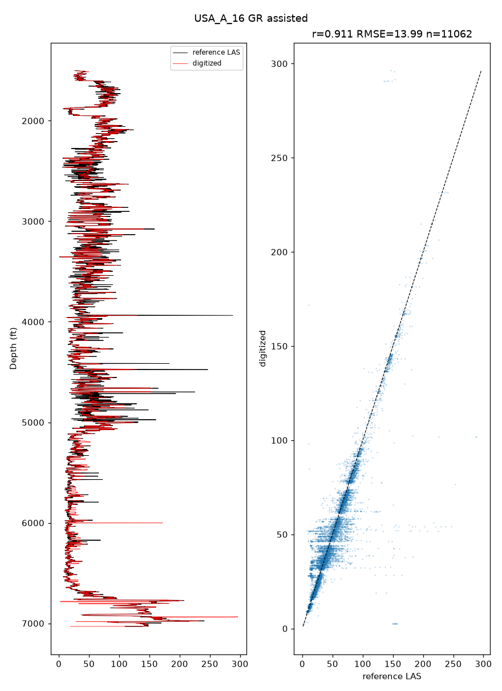
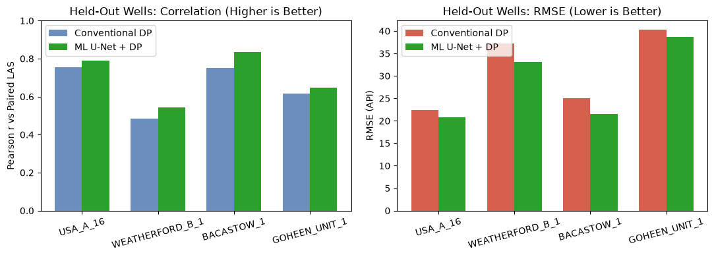

<p align="center"></p>

# pyLogDigitizer

[](https://pypi.org/project/pylogdigitizer/) [](https://pepy.tech/project/pylogdigitizer) [](https://doi.org/10.5281/zenodo.23832013) [](./LICENSE)

v0.1.0

> [!WARNING]
> **pyLogDigitizer** is under active development, and many functions are still experimental and not fully validated. Please use with caution.

**pyLogDigitizer** turns scanned paper well logs (TIFF) into LAS files. Lots of older wells only exist as paper scans, and digitizing them by hand is slow and hard to check. So I built a tool that does the tedious parts (finding tracks and grids, reading depth labels, tracing curves) and gives you a local browser app to check and fix every step. Curves that run off the track and come back on a backup scale get unwrapped automatically. Everything runs on your own machine and nothing is uploaded.

## Installation

```bash
pip install pylogdigitizer
```

From source (builds the Rust tracer, needs a Rust toolchain):

```bash
git clone https://github.com/GeoLarryLai/pyLogDigitizer && cd pyLogDigitizer
pip install .
```

Or `conda env create -f environment.yml && conda activate pylogdigitizer`, then `maturin develop --release`.
Without the Rust part everything still works, only slower.

## Citation

Lai, L.S.-H. (2026) pyLogDigitizer. *Zenodo*, [https://doi.org/10.5281/zenodo.23832013](https://doi.org/10.5281/zenodo.23832013)


*The whole idea in one picture: a scanned paper log going in and a LAS curve coming out.*

## What it can do

- Find tracks and grids, deskew the scan, read depth labels (OCR) and calibrate scales, including backup-scale wraparound
- Trace curves with a fast dynamic-programming tracer (Rust, with a Python fallback); click anchors to re-trace just one part
- Optionally train a U-Net cost map on your own corrected traces; batch runs send low-confidence curves to review
- Compare results against a reference LAS and write LAS 2.0
- Work through a guided browser app, a web editor, the command line or Python

## Examples


*The guided app with a traced curve laid over the scan, ready for you to review and fix.*


*A curve digitized with the assisted workflow, checked against the paired Kansas Geological Survey (KGS) LAS.*


*On held-out Kansas wells, correlation and error against the reference LAS for the conventional and the ML cost map.*

Notebooks: `notebooks/01_conventional_vs_assisted.ipynb` (one scan, step by step) and
`notebooks/02_kansas_ml_train_batch.ipynb` (train the cost map and batch-digitize). Example scans and LAS files are
from the [Kansas Geological Survey](https://www.kgs.ku.edu/) (`example_data/SOURCES.txt`).

## Quick start

```bash
pylogdigitizer info example_data/USA_A_16_15-055-20536/4342.tif   # scan size and resolution
pylogdigitizer-app .                        # guided app at http://127.0.0.1 (local only)
pylogdigitizer editor . --open              # web editor
```

The same from Python:

```python
from pylogdigitizer import workflows as wf
R = wf.digitize_curve("example_data/USA_A_16_15-055-20536/4342.tif", track="track1", scale=(0, 150),
                      first_depth=1500, depth_range=(1500, 7030), backup=(150, 300))
R["depth"], R["value"], R["conf"]           # then las_export.resample + write_las
```

`backup=(150, 300)` is the **backup scale**: when a curve runs off the edge of its track it is redrawn from the other
edge on a second scale, and the tracer unwraps it.

Third-party notices and data credits: [`NOTICE`](NOTICE).
